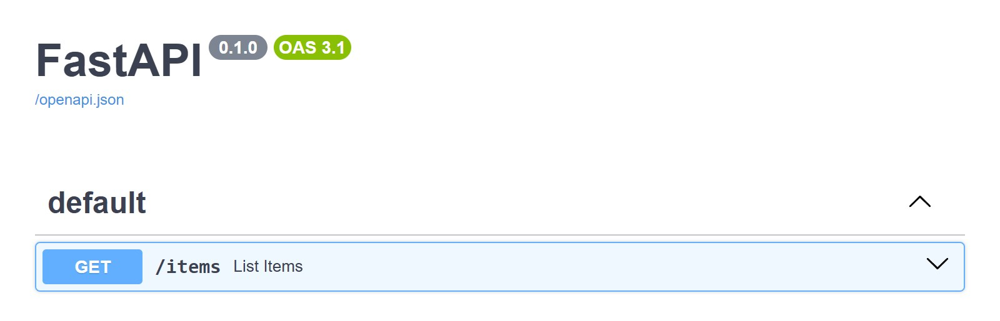
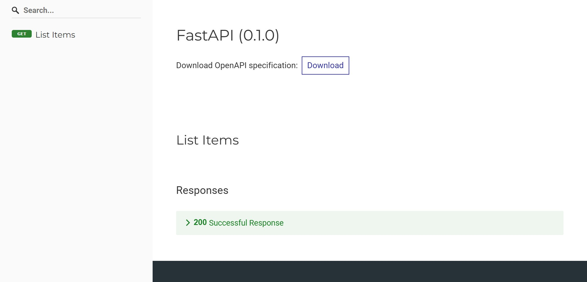

<div class="hero-logo" markdown>
{ width=128 }
</div>

# FastAPI CSP Docs { .hero }

<p class="hero-tagline">CSP-safe Swagger UI, ReDoc and OAuth2 redirect pages for FastAPI, so your Content-Security-Policy can drop 'unsafe-inline'.</p>

FastAPI's built-in `/docs`, `/redoc`, and OAuth2 redirect pages embed inline `<script>`/`<style>` tags, so they break under a Content-Security-Policy without `'unsafe-inline'`. Following FastAPI's own ["Custom Docs UI Static Assets"](https://fastapi.tiangolo.com/how-to/custom-docs-ui-assets/) recipe only swaps the CDN URLs for local ones; the inline content stays. `fastapi-csp-docs` replaces all three pages with versions that load every script and stylesheet from a separate endpoint, with no inline content anywhere.

## What you get

Swagger UI and ReDoc keep working under a Content-Security-Policy with no `'unsafe-inline'`. These screenshots come from the [Quick start](quickstart.md) app, with its CSP enforced.

=== "Swagger UI"

    { loading=lazy }

=== "ReDoc"

    { loading=lazy }

## Features

- **Drop-in `setup()`**: one call replaces the `/docs`, `/redoc`, and OAuth2 redirect wiring. See the [Quick start](quickstart.md).
- **Fails at startup on misconfiguration**: `setup()` raises `RuntimeError` if the app's built-in docs are still enabled.
- **CDN or self-hosted**: the default asset URLs point at jsdelivr, and [your own static files](guides/self-hosted.md) replace them with `script-src 'self'`.
- **Reverse proxy and sub-app support**: URLs include the ASGI `root_path` of each request, so [a mount or `--root-path`](advanced/reverse-proxy-and-sub-apps.md) needs no configuration.
- **Independent paths**: `docs_url` and `redoc_url` are [`setup()` parameters](advanced/paths.md), and `None` skips either page.
- **Public content generators**: the functions `setup()` uses are exported for [routes you write yourself](advanced/manual-wiring.md).

## Requirements

- Python >= 3.10
- FastAPI >= 0.120.0

## Installation

=== "pip"

    ```bash
    pip install fastapi-csp-docs
    ```

=== "uv"

    ```bash
    uv add fastapi-csp-docs
    ```

Continue with the [Quick start](quickstart.md).
