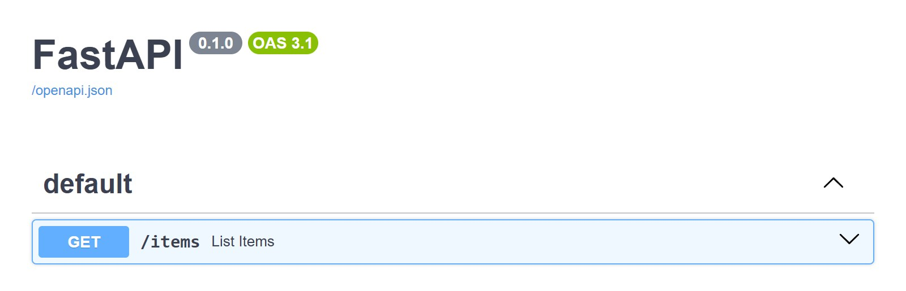
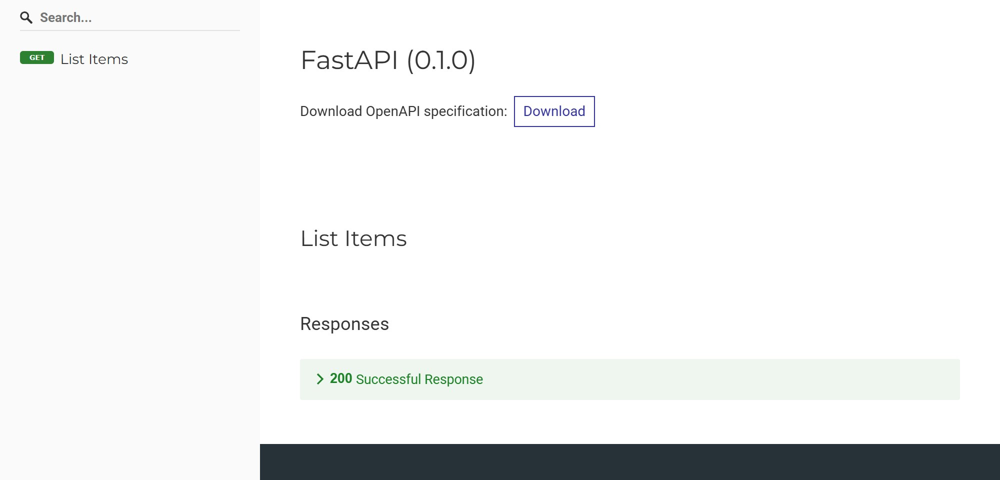

# Quick start

Create the app with its built-in docs disabled, send your Content-Security-Policy, and call `setup()`:

```python
--8<-- "docs_src/quickstart/app.py:snippet"
```

Save the code as `main.py` and start the server:

```bash
uvicorn main:app --reload
```

Open `/docs` and `/redoc`: both pages render, and the browser console reports no CSP violations.

=== "Swagger UI"

    

=== "ReDoc"

    

`setup()` registers these routes, all excluded from the OpenAPI schema:

| Route | Serves |
|---|---|
| `/docs` | Swagger UI page |
| `/docs/swagger-initializer.js` | Script that starts Swagger UI |
| `/docs/oauth2-redirect` | OAuth2 redirect page |
| `/docs/oauth2-redirect.js` | OAuth2 redirect script |
| `/redoc` | ReDoc page |
| `/redoc/redoc.css` | CSS reset ReDoc needs |

## Built-in docs still enabled

`setup()` raises `RuntimeError` when the page it would register is still enabled on the app. With `FastAPI()` and no arguments, the message is:

```text
fastapi_csp_docs.setup() cannot mount Swagger UI at '/docs' because the app still serves its built-in docs at '/docs'. Create the FastAPI app with docs_url=None to disable it first, e.g. FastAPI(docs_url=None).
```

## Next steps

- [Writing the CSP](guides/csp.md) explains every directive in this policy and how to narrow it.
- [Fully self-hosted docs](guides/self-hosted.md) removes the CDN.
